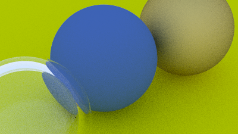
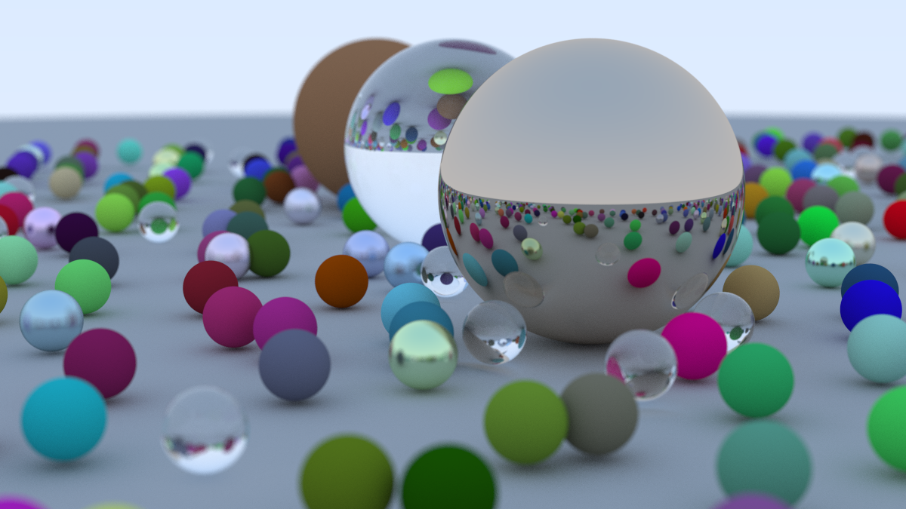

# Raytracer

A C++ ray tracing project based on the book "Ray Tracing in One Weekend" from Peter Shirley, Trevor David Black and Steve Hollasch with multithreading and a QT application.
The renderer traces rays through a 3D scene, computes pixel colors using material scattering, and exports the resulting image. The desktop application provides controls for loading a scene, configuring a render, monitoring progress, cancelling an operation, and viewing the result.

## Architecture overview

The code is split into two main parts:

- **`Raytracer`** owns the rendering domain: camera, scene, renderer, image buffer, thread pool and image export.
- **`Application`** provides the Qt user interface and coordinates rendering through `RenderController` and `RenderWorker`.

## Libs

- **Qt Widgets** (and Qt's meta-object / signal-slot system) for the desktop application.
- **nlohmann/json** for JSON serialization.
- **stb** for PNG/JPEG image writing.

All of them are installed via vcpkg.

## Scene files

Scenes are loaded from JSON through the scene serialization system. The serializers cover:
- Camera configuration.
- Geometric objects (the sphere implementation in this snapshot).
- Materials (Lambertian, metal and dielectric).
- Sky models (gradient sky).

2 scene examples are present into "Scenes" folder.

